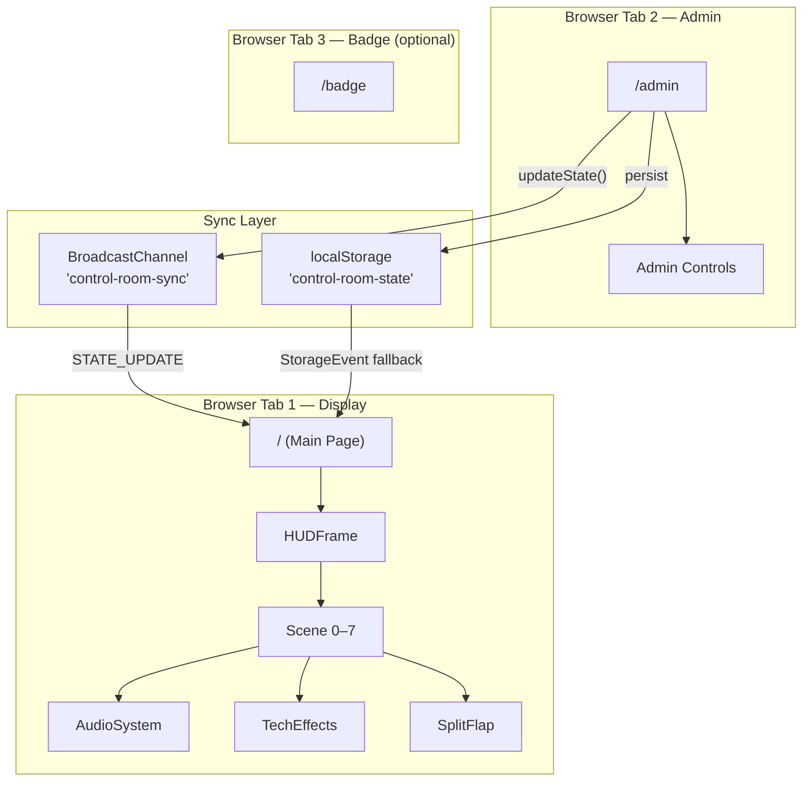

# Nikki Control Room — Technical Documentation

> A cinematic, real-time birthday surprise experience built as a **"hacking/control room"** themed Next.js app. The app disguises a live delivery logistics dashboard, then interrupts it with a dramatic anomaly-detection sequence that culminates in revealing a birthday message for **Nikki Okrah**, Founder & CEO of Chaku Foods.

---

## Table of Contents

1. [Overview](#overview)
2. [Architecture](#architecture)
3. [Tech Stack](#tech-stack)
4. [Project Structure](#project-structure)
5. [Routes & Pages](#routes--pages)
6. [Scene Flow & Cinematic Sequence](#scene-flow--cinematic-sequence)
7. [State Synchronization](#state-synchronization)
8. [Component Reference](#component-reference)
9. [Audio System](#audio-system)
10. [Visual Effects Library (TechEffects)](#visual-effects-library-techeffects)
11. [Design System & CSS](#design-system--css)
12. [Admin Panel Guide](#admin-panel-guide)
13. [Setup & Development](#setup--development)
14. [Deployment Notes](#deployment-notes)

---

## Overview

**Nikki Control Room** (internally `temp_app`) is a theatrical, single-use experience designed to be shown on a big screen during a live event. The concept:

1. The audience sees what appears to be a **real logistics control room dashboard** ("CWAR Delivery Event Signal Board") tracking deliveries across West Africa.
2. Suddenly, an **anomaly is detected** — alarms sound, the screen glitches, and a hacking-style investigation begins.
3. The "investigation" scans a database, identifies **Nikki Okrah** as the anomaly, compares mission parameters, and escalates through a 3-2-1 countdown.
4. The reveal: **"HAPPY BIRTHDAY NIKKI!"** — confetti, celebration music, and the incident is marked as resolved.
5. A QR code appears that links to a downloadable **"Honorary Fellow Operator"** badge.

An **admin panel** (`/admin`) runs in a separate browser tab to remotely control the display in real time via `BroadcastChannel` + `localStorage`.

---

## Architecture



> [!IMPORTANT]
> The admin and display **must run in the same browser** (same origin) for `BroadcastChannel` to work. They sync instantly across tabs — no server, no Supabase.

---

## Tech Stack

| Layer | Technology | Version |
|-------|-----------|---------|
| Framework | Next.js (App Router) | 16.3.5 |
| React | React + React DOM | 19.2.8 |
| Styling | Tailwind CSS v4 | ^4 |
| Animations | Framer Motion | ^13.3.0 |
| Audio | Howler.js | ^2.2.4 |
| Confetti | canvas-confetti | ^1.9.4 |
| QR Code | qrcode.react | ^4.2.0 |
| Screenshot | html-to-image | ^1.11.13 |
| Icons | Lucide React | ^1.46.0 |
| Fonts | Montserrat + JetBrains Mono (via `next/font`) | — |

---

## Project Structure

```
Nikki/
├── public/
│   └── audio/                        # 7 WAV/AIFF sound effects
│       ├── alert-beep.wav
│       ├── alert-detected-voice.aiff
│       ├── ambient-hum.wav
│       ├── celebration-horn.wav
│       ├── celebration-music.wav
│       ├── flip-click.wav
│       └── whoosh-transition.wav
├── src/
│   ├── app/
│   │   ├── layout.tsx                # Root layout (fonts + AudioSystemProvider)
│   │   ├── page.tsx                  # Main display — scene orchestrator
│   │   ├── globals.css               # Design tokens, CRT effects, glitch animations
│   │   ├── admin/
│   │   │   └── page.tsx              # Admin control panel
│   │   └── badge/
│   │       └── page.tsx              # Downloadable operator badge
│   ├── components/
│   │   ├── AudioSystem.tsx           # Howler.js audio context provider
│   │   ├── HUDFrame.tsx              # HUD overlay (brackets, rain, ticker, waveform)
│   │   ├── LiveDashboard.tsx         # Fake logistics dashboard (Scene 0)
│   │   ├── SplitFlap.tsx             # Split-flap / decrypt text animator
│   │   ├── TechEffects.tsx           # 8 reusable visual effect components
│   │   ├── TerminalScanBackground.tsx # Scrolling hex terminal background
│   │   └── scenes/
│   │       ├── Scene0.tsx            # Dashboard (idle)
│   │       ├── Scene1.tsx            # "ANOMALY DETECTED"
│   │       ├── Scene2.tsx            # Personnel scan / match found
│   │       ├── Scene3.tsx            # Mission parameter comparison
│   │       ├── Scene3b.tsx           # 3-2-1 countdown
│   │       ├── Scene4.tsx            # Birthday reveal + confetti
│   │       └── Scene5.tsx            # Wrap-up / QR code
│   └── lib/
│       └── useSyncState.ts           # Cross-tab state sync hook
└── package.json
```

---

## Routes & Pages

### `/ ` — Main Display ([page.tsx](file:///Users/abdulrahmanisah/Documents/Nikki/src/app/page.tsx))

The primary audience-facing screen. Renders the current scene inside a [`HUDFrame`](file:///Users/abdulrahmanisah/Documents/Nikki/src/components/HUDFrame.tsx) with animated transitions. Handles:

- **Scene orchestration** — maps `sceneIndex` (0–7) to scene components
- **Glitch transitions** — white-flash + RGB-split overlay between scenes 0→1, 1→2, 2→3
- **Auto-progression** — scenes auto-advance on timed delays (configurable)
- **Auto-trigger** — can be set to automatically start at a specific wall-clock time
- **Keyboard controls** — `Space` to advance, `Escape`/`Backspace` to reset to Scene 0
- **Click/tap to advance** — the entire screen is clickable

### `/admin` — Control Panel ([page.tsx](file:///Users/abdulrahmanisah/Documents/Nikki/src/app/admin/page.tsx))

The operator's dashboard for controlling the live experience. Provides:

- **One-tap Launch** — instant jump to Scene 1 to start the sequence
- **Scene Control** — prev/next buttons + direct jump grid for all 8 scenes
- **Countdown Timer** — preset (1m, 2m, 5m, 10m, 15m, 30m) or custom countdown that auto-triggers the sequence
- **Auto-Trigger** — arm the system to fire at an exact HH:MM:SS clock time
- **Clock Configuration** — toggle between real-time and simulated time
- **Audio Overrides** — mute all audio, skip current audio, adjust alert beep volume
- **Transition Timings** — tweak cross-fade, glitch cut, and countdown step durations (ms)
- **Connection Status** — shows whether the display tab is connected

### `/badge` — Operator Badge ([page.tsx](file:///Users/abdulrahmanisah/Documents/Nikki/src/app/badge/page.tsx))

A standalone page for Nikki (or guests) to view and download a personalized "Honorary Fellow Operator" badge as a PNG image. Features:

- Styled as a tactical ID card with radar rings, circuit traces, hexagonal badge icon
- Displays name, designation, field record, and incident details
- "Save Badge to Photos" button uses `html-to-image` for high-DPI export (3x pixel ratio)

---

## Scene Flow & Cinematic Sequence

The experience progresses through 8 scene states (indices 0–7). Some scenes auto-advance; one requires user interaction.

```mermaid
stateDiagram-v2
    [*] --> Scene0: Initial State
    
    Scene0 --> Scene1: Click/Space/Auto-trigger
    
    Scene1 --> Scene2: Auto (6s)
    note right of Scene1: 🔴 "ANOMALY DETECTED"\nAlarm + voice alert

    Scene2 --> Scene3: Auto (8s)
    note right of Scene2: 🔍 Personnel scan\nIdentifies Nikki Okrah

    Scene3 --> Scene3b: Auto (10s)
    note right of Scene3: ⚖️ Mission comparison\n"MATCH: 98%"

    Scene3b --> Scene4_reveal: Auto (countdown 3-2-1)
    note right of Scene3b: ⏱ Escalation countdown\nBeep tempo increases

    Scene4_reveal --> Scene4_subtext: Auto (5s)
    note right of Scene4_reveal: 🎂 "HAPPY BIRTHDAY NIKKI!"\nConfetti + music

    Scene4_subtext --> Scene5: Auto (6s)
    note right of Scene4_subtext: 🏅 "HONORARY FELLOW OPERATOR"

    Scene5 --> [*]: End
    note right of Scene5: 📋 Incident report + QR code
```

### Scene Details

| Index | Component | Name | Duration | Audio | Visual Highlights |
|-------|-----------|------|----------|-------|-------------------|
| **0** | `Scene0` | Dashboard (Idle) | Until triggered | None | Fake logistics dashboard, hex dump streams, ambient data |
| **1** | `Scene1` | Anomaly Detected | 6s auto → Scene 2 | `alert-beep` (loop), `alert-detected-voice` | Red pulse, network radar, decrypt text "ANOMALY DETECTED", terminal log |
| **2** | `Scene2` | Personnel Scan | 8s auto → Scene 3 | Beep continues (60% vol) | Sequential reveals: cross-reference → match → name/role → classification → global activity → conclusion |
| **3** | `Scene3` | Deep Scan | 10s auto → Scene 3b | Beep continues (70% vol) | Mission comparison: "OUR ROOM" vs "HER ROOM", progress bar, "MATCH: 98%" |
| **4** | `Scene3b` | Countdown | 3-2-1 auto → Scene 5 | Beep accelerates (gap: 600→450→300ms), `whoosh-transition` at "1" | Giant countdown numbers, intense hex dumps, pulsing radar |
| **5** | `Scene4` | Birthday Reveal | 5s auto → Scene 6 | Beep stops, `celebration-horn`, then `celebration-music` | "HAPPY BIRTHDAY NIKKI!", confetti bursts (every 700ms), floating emojis |
| **6** | `Scene4` | Honorary Operator | 6s auto → Scene 7 | Music continues | Adds "HONORARY FELLOW OPERATOR" + "GLOBAL NETWORK..." subtext |
| **7** | `Scene5` | Finale / Wrap | End state | Music fades to 20% | Incident report card, typing log, QR code to `/badge` |

> [!NOTE]
> Scene indices 5 and 6 both render `Scene4` with different `showSubtext` props. Scene index 4 renders `Scene3b`. This mapping is intentional — the internal scene index doesn't always match the component name.

---

## State Synchronization

### [`useSyncState`](file:///Users/abdulrahmanisah/Documents/Nikki/src/lib/useSyncState.ts)

A custom hook that synchronizes state between the admin tab and display tab using two mechanisms:

1. **`BroadcastChannel`** (`"control-room-sync"`) — instant, same-origin cross-tab messaging
2. **`localStorage`** (`"control-room-state"`) — persistence + fallback via `StorageEvent`

#### State Shape (`GlobalState`)

```typescript
type GlobalState = {
  sceneIndex: number;                    // 0–7
  timeConfig: {
    useRealTime: boolean;                // true = wall clock, false = simulated
    simulatedTime: string;               // "HH:MM:SS"
  };
  transitionTimings: {
    crossFadeMs: number;                 // Default: 1000
    glitchCutMs: number;                 // Default: 200
    countdownIntervalMs: number;         // Default: 1000
  };
  muted: boolean;                        // Global audio mute
  alertBeepVolume: number;               // 0–1 (default: 0.6)
  autoTriggerConfig: {
    enabled: boolean;                    // Armed/disarmed
    triggerTime: string;                 // "HH:MM:SS"
  };
};
```

#### Message Protocol

| Message Type | Direction | Payload |
|-------------|-----------|---------|
| `STATE_UPDATE` | Admin → Display | Full `GlobalState` object |
| `PING` | Both → Both | `{ from: "admin" \| "display" }` |
| `PONG` | Both → Both | `{ from: "admin" \| "display" }` |
| `SKIP_AUDIO` | Admin → Display | None (triggers `skip_audio` event) |

#### Connection Detection

- Heartbeat `PING` every 1.5s
- Connection lost if no `PONG` received within 4s
- `isConnected` boolean exposed to admin UI

---

## Component Reference

### [`HUDFrame`](file:///Users/abdulrahmanisah/Documents/Nikki/src/components/HUDFrame.tsx)

The persistent overlay wrapper around all scenes. Provides the tactical "control room" aesthetic.

| Element | Description |
|---------|-------------|
| Corner brackets | L-shaped borders that change color: green (idle) → coral (alert) → coral/40 (celebration) |
| Status badges | "SIG.INT", scene number, "ENCRYPTED" in corners |
| Matrix rain | 12 animated columns of random chars (Japanese katakana + symbols) |
| Coordinate HUD | Fake lat/lng/alt readout, bottom-left |
| Signal waveform | Animated audio bars, top-right |
| Data ticker | Scrolling status text along the bottom edge |
| HUD grid | Subtle green grid lines (80px spacing) |

### [`SplitFlap`](file:///Users/abdulrahmanisah/Documents/Nikki/src/components/SplitFlap.tsx)

Animates text character-by-character in two modes:

| Mode | Visual | Use Case |
|------|--------|----------|
| `"flap"` | Airport split-flap display (3D flip, black tiles, center divider line) | Birthday reveal, incident report |
| `"decrypt"` | Hacker-style text decryption (random chars → final text + blinking cursor) | Alert messages, investigation data |

**Props:**

| Prop | Type | Default | Description |
|------|------|---------|-------------|
| `text` | `string` | — | Target text to display |
| `fontSize` | `string` | `"text-xl"` | Tailwind font size class |
| `color` | `string` | `"text-white"` | Tailwind color class |
| `flipSpeedMs` | `number` | `50` | Milliseconds per character flip |
| `staggerDelayMs` | `number` | `40` | Delay between characters starting |
| `mode` | `"flap" \| "decrypt"` | `"flap"` | Animation style |

### [`LiveDashboard`](file:///Users/abdulrahmanisah/Documents/Nikki/src/components/LiveDashboard.tsx)

A highly detailed fake logistics dashboard that appears in Scene 0. Mimics a "CWAR Delivery Event Signal Board" with:

- **5 pipeline columns**: Created → Tendering → Loading → In Transit → At Customer
- Each column has: main count, dwell time histogram, oldest held items, entering feed
- Numbers "breathe" with random ±2 variations for realism
- Entering feed cycles every 2.5s
- Live clock (real or simulated)
- Weather ticker at the bottom
- Two timezones: WAT and GMT

### [`TerminalScanBackground`](file:///Users/abdulrahmanisah/Documents/Nikki/src/components/TerminalScanBackground.tsx)

A full-screen scrolling hex-code background that fills the viewport with random `0x...` addresses and scan data. Radially masked to fade toward edges.

**Props:** `color`, `opacity`, `intervalMs` (scroll speed)

---

## Audio System

### [`AudioSystem`](file:///Users/abdulrahmanisah/Documents/Nikki/src/components/AudioSystem.tsx)

A React context provider wrapping **Howler.js**. Provides centralized audio management across all scenes.

#### Audio Tracks

| ID | File | Type | Default Vol | Usage |
|----|------|------|------------|-------|
| `ambient-hum` | `ambient-hum.wav` | Loop | 0.5 | Background ambience (unused in current flow) |
| `alert-detected-voice` | `alert-detected-voice.aiff` | One-shot | 0.8 | Voice announcing "Alert detected" — Scene 1 |
| `alert-beep` | `alert-beep.wav` | Custom loop | 0.6 | Alarm beep — Scenes 1–3b (manual loop with configurable gap) |
| `flip-click` | `flip-click.wav` | Overlap OK | 0.2 | Split-flap character settle sound |
| `whoosh-transition` | `whoosh-transition.wav` | One-shot | 0.9 | Transition whoosh — Scene 3b countdown at "1" |
| `celebration-horn` | `celebration-horn.wav` | One-shot | 1.0 | Party horn — Scene 4 reveal |
| `celebration-music` | `celebration-music.wav` | Loop | 0.7 | Background music — Scenes 4–5 (fades to 0.2 in Scene 5) |

#### Beep Loop System

The `alert-beep` uses a **custom loop** (not Howler's native loop) to allow dynamic gap control:
- Scene 1: 800ms gap
- Scene 2: 800ms gap, 60% volume
- Scene 3: 800ms gap, 70% volume
- Scene 3b: 600ms → 450ms → 300ms (accelerating countdown)
- Scene 4+: Stopped

#### API

```typescript
play(id: AudioId): void      // Start playing (beep starts custom loop)
stop(id: AudioId): void      // Stop playing
fade(id, from, to, ms): void // Volume fade
rate(id, speed): void         // Playback rate
volume(id, vol): void         // Set volume
setBeepGap(gap: number): void // Adjust beep loop silence gap (ms)
isReady: boolean              // True after all Howl instances are created
```

---

## Visual Effects Library (TechEffects)

[`TechEffects.tsx`](file:///Users/abdulrahmanisah/Documents/Nikki/src/components/TechEffects.tsx) exports 8 reusable effect components:

| # | Component | Description | Key Props |
|---|-----------|-------------|-----------|
| 1 | `GlitchText` | Text that briefly corrupts 1–3 random chars with symbols | `glitchInterval`, `glitchDuration` |
| 2 | `HexDumpStream` | Scrolling memory dump (`0x004000 AA BB CC...`) | `lines`, `speed`, `side` ("left"/"right") |
| 3 | `NetworkPulse` | SVG radar/sonar with concentric pulsing rings + sweep line | `color`, `size` |
| 4 | `TypingLog` | Terminal output that types line-by-line with a cursor | `messages`, `typingSpeed`, `lineDelay`, `loop` |
| 5 | `SignalWaveform` | Animated audio-style vertical bars | `bars`, `color`, `height` |
| 6 | `DataTicker` | Horizontally scrolling text ribbon | `items`, `speed` |
| 7 | `CoordinateHUD` | Floating lat/lng/alt readout with "LOCKED" indicator | `className` |
| 8 | `HackProgress` | Hacking-style progress bar with jitter | `label`, `duration`, `color`, `loop` |

---

## Design System & CSS

### Color Palette

| Token | Hex | Usage |
|-------|-----|-------|
| `--background` | `#03080A` | Page background (ultra-dark) |
| `--color-brand-teal` | `#061114` | Dark teal accent |
| `--color-brand-coral` | `#E8604C` | Primary accent, alerts |
| `--color-brand-cream` | `#F2E9DD` | Warm neutral |
| `--color-brand-red` | `#D63C2C` | Danger, alert phase |
| `--color-brand-green` | `#3FA66E` | Success, nominal state |

### Typography

| Font | Variable | Usage |
|------|----------|-------|
| **Montserrat** | `--font-montserrat` | Sans-serif body text |
| **JetBrains Mono** | `--font-jetbrains-mono` | Monospace — HUD, data, terminals |

### CSS Effects ([globals.css](file:///Users/abdulrahmanisah/Documents/Nikki/src/app/globals.css))

| Effect | Description |
|--------|-------------|
| **CRT Scanlines** | `body::after` — repeating 2px/4px transparent/dark stripes, drifting animation |
| **Cinematic Vignette** | `body::before` — radial gradient darkening edges |
| **Film Grain** | SVG `feTurbulence` noise overlay at 5% opacity |
| **Glitch Transition** | `.glitch-transition-out`, `.glitch-layer-1/2` — clip-path slice + RGB split animations |
| **Text Glow** | `.text-glow-coral/green/red/white` — colored text-shadow utilities |
| **Chromatic Aberration** | `.chromatic-flicker` — brief RGB split on text every ~8s |
| **Horizontal Jitter** | `.text-jitter` — subtle 1–2px X translation flicker |
| **HUD Grid** | `.hud-grid` — 80px green grid lines at 3% opacity |
| **Crosshair Marks** | `.crosshair` — pseudo-element crosshair overlay |

---

## Admin Panel Guide

### Quick Start: Running the Experience

1. Open **Tab 1**: `http://localhost:3000` (full-screen this on the projector/TV)
2. Open **Tab 2**: `http://localhost:3000/admin` (keep this on your laptop)
3. Wait for the "Display Connected" badge to turn green
4. Either:
   - Click **LAUNCH** to start immediately, or
   - Set a **countdown** (e.g., 5 minutes) and click **Start Countdown**

### Admin Sections

| Section | Description |
|---------|-------------|
| **🔴 One-Tap Launch** | Red button — immediately jumps to Scene 1 and starts the sequence |
| **🔵 Scene Control** | Shows current scene, Prev/Next, direct jump grid (0–7), Reset to Scene 0 |
| **🟣 Auto-Trigger** | Countdown timer with presets (1–30 min) OR exact-time trigger (HH:MM:SS) |
| **🟢 Clock Configuration** | Toggle real time vs. simulated time, set simulated HH:MM:SS |
| **🔴 Emergency & Audio** | Alert beep volume slider, mute toggle, skip current audio |
| **⚫ Transition Timings** | Cross-fade (ms), glitch cut (ms), countdown step (ms) |

### Connection Indicators

| Badge | Meaning |
|-------|---------|
| 💻 Local Only | Using BroadcastChannel (expected — Supabase was removed) |
| ✅ Display Connected | Display tab is open and responding to heartbeats |
| ❌ No Display Detected | Display tab is closed or not responding |

---

## Setup & Development

### Prerequisites

- Node.js 18+
- npm

### Install & Run

```bash
cd Nikki
npm install
npm run dev
```

The app runs at `http://localhost:3000` by default.

### Environment Variables

The `.env.local` file exists but the app currently runs **without any external services** — Supabase was removed in favor of local-only BroadcastChannel sync.

### Key Commands

| Command | Description |
|---------|-------------|
| `npm run dev` | Start dev server with hot reload |
| `npm run build` | Production build |
| `npm run start` | Start production server |
| `npm run lint` | Run ESLint |

---

## Deployment Notes

> [!WARNING]
> The admin ↔ display sync uses `BroadcastChannel`, which requires **both tabs in the same browser on the same device**. This will NOT work across separate devices or browsers.

### For a Live Event

1. **Single Laptop Setup**: Open admin + display in the same browser. Mirror/extend display tab to projector.
2. **Audio**: Ensure the browser tab has audio permissions. Click anywhere on the display first to unlock audio context.
3. **Full Screen**: Press `F11` or use the browser's full-screen mode on the display tab.
4. **Rehearsal**: Test the full sequence at least once before the event. Use the admin's Scene Control to jump directly to any scene.

### If Cross-Device Sync is Needed

The codebase previously used Supabase Realtime. To re-enable:
1. Add Supabase credentials to `.env.local`
2. Modify [`useSyncState.ts`](file:///Users/abdulrahmanisah/Documents/Nikki/src/lib/useSyncState.ts) to subscribe to a Supabase Realtime channel
3. Broadcast state updates through the channel in addition to `BroadcastChannel`

### Badge Page

The `/badge` page is fully standalone and can be shared as a link. It works on mobile (tap the download button) and generates a high-quality 3x PNG.
